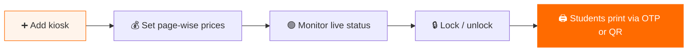
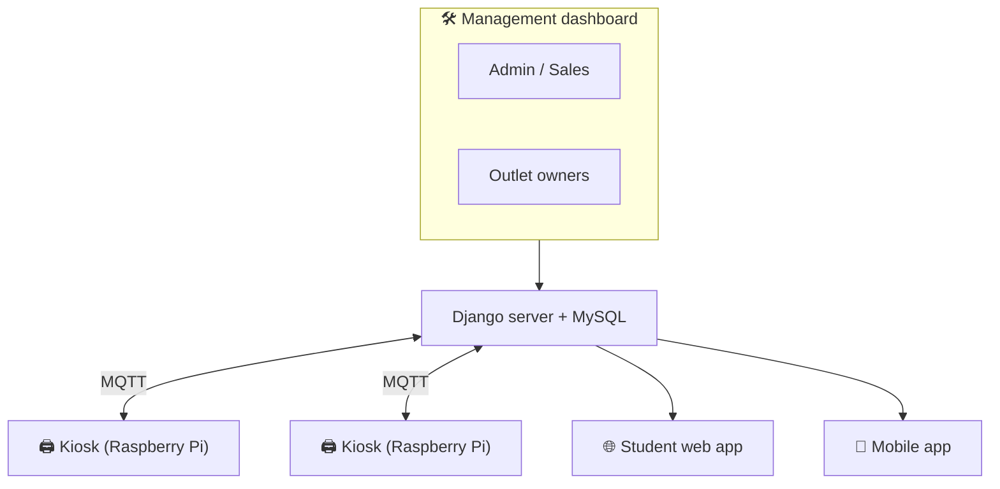

# 🛠️ Uprint Kiosk Management

### Run a city-wide printing network from one dashboard.

The control center behind **[Uprint](https://uprintbd.com)**, a network of 24/7 self-service printing kiosks across university campuses in Chattogram, Bangladesh. It manages kiosks, outlets, pricing, live device health and who can print where.

---

## ⚡ What it solves

> Many kiosks, many outlet owners, different prices, printers that go offline. Without one place to control it all, the network breaks.

**Kiosk Management** gives admins, sales and outlet owners one dashboard to add kiosks, set prices, watch device health and control availability.

---

## ✨ Features

| | Feature | What it does |
|:-:|---|---|
| 🖨️ | **Kiosk CRUD** | Add, edit and remove kiosks under each outlet |
| 💰 | **Page-wise pricing** | Per-kiosk price ranges for B&W and colour, with separate two-sided rates |
| 🟢 | **Live device health** | Online, Printer Disconnected or Offline, reported by each device |
| 🔒 | **Active / Locked** | Lock a kiosk instantly so it cannot accept prints |
| 🔑 | **OTP + QR printing** | Each kiosk screen shows an OTP entry and a QR code for direct print |
| 🏪 | **Outlet management** | Outlet owners manage their own kiosks |
| 👥 | **Role-based access** | Admin, sales, outlet and student roles each see only what they need |

### 🚧 In progress
- 👁️ **Shown / Hidden** visibility for kiosks and whole outlets
- 🔍 **Searchable outlet and printer dropdowns** with device counts
- 🛡️ **Tighter role checks** on edit, delete and API endpoints

---

## 🏗️ Architecture

---

## 👨‍💻 My role

- Built and maintain the kiosk, outlet and pricing management used in production
- Worked across the stack: Django views and models, Bootstrap templates, jQuery and device communication
- Prioritised **zero data loss** and **no downtime**: every schema change is backed up, reviewed and migrated safely on the live database

---

**Part of the Uprint platform:**
[📄 Uprint Lab Sheet Builder](https://github.com/MSSohan/Uprint-Lab-Sheet-Builder) ·
[📍 Find Nearest Uprint Kiosk](https://github.com/MSSohan/Find-Nearest-Uprint-Kiosk) ·
[🛠️ Uprint Kiosk Management](https://github.com/MSSohan/Uprint-Kiosk-Management)

The production source code is private. This repository is a showcase of the feature.

